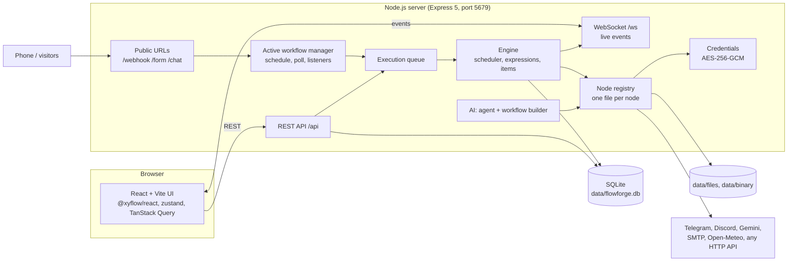

# Atlas Flow

Version personnalisée de FlowForge : identité bleu/turquoise, navigation principale en français, favoris personnels, guide intégré et premier workflow prêt à exécuter sans clé API.

**Démarrage et utilisation en bref : [fct.md](fct.md).** Lancez `npm install`, puis `npm start`, et ouvrez http://localhost:5679.

Les sections suivantes documentent le moteur FlowForge d’origine, conservé dans cette adaptation. Certains écrans avancés et noms techniques restent en anglais.

A visual workflow automation tool inspired by [n8n](https://n8n.io), built as a school project: triggers, 50+ nodes,
expressions, a live execution view, credentials, integrations (Telegram, Discord, Gemini, email, weather), an AI Agent
and an AI Workflow Builder, a time-travel debugger and a guided Demo Mode, all running locally on Node.js + SQLite.
It runs side by side with real n8n (FlowForge uses port **5679**, n8n uses 5678).

**Dépôt :** [Atlas Flow](https://github.com/anasIRISI/Atlas-Flow)

> - **New here? Start with [HOW_TO_RUN.md](HOW_TO_RUN.md)** (install, keys, tests, phone access, common problems).
> - Feature status (what is implemented and tested): [FEATURES.md](FEATURES.md).
> - What to prepare before a demo (keys, machine, checklist): [need.md](need.md). Key setup guides: [API_SETUP.md](API_SETUP.md).

## Contents

- [Install and run](#install-and-run) · [Features](#features) · [Tech stack](#tech-stack) · [Project structure](#project-structure)
- [Architecture](#architecture) · [Webhooks and triggers](#webhooks-and-triggers) · [Email and forms](#email-and-forms)
- [Data, files and HTTP nodes](#data-files-and-http-nodes) · [Integrations](#integrations-telegram-discord-gemini-weather-chat)
- [AI Agent and AI Workflow Builder](#ai-agent-and-ai-workflow-builder) · [Demo Mode and time travel](#demo-mode-and-time-travel)
- [Examples](#examples) · [Testing](#testing) · [Open FlowForge from a phone](#open-flowforge-from-a-phone)
- [Troubleshooting](#troubleshooting) · [Commands](#commands) · [Teacher demo script](#teacher-demo-script-5-minutes)

## Install and run

Requirements: Node.js **20.11 or newer** (Node 22 LTS recommended) and npm.

```bash
npm install
npm start
```

Open **http://localhost:5679** and create the owner account (first run only). The first `npm start` builds the app
(15-30 seconds); later starts are instant unless the source changed. Data is stored in `./data`. Configuration is
optional: copy `.env.example` to `.env` to change the port, the public URL, limits or SMTP fallbacks.

Development with hot reload: `npm run dev` and open http://localhost:5173.

## Features

- **Editor**: canvas with minimap, node creator, node panel (Input / Parameters / Output), expression editor with
  autocomplete and live preview, undo/redo, copy/paste, auto-layout, Cmd/Ctrl+K command palette, pinned data,
  partial runs.
- **Live execution**: glowing nodes, particles on the edges, item counts, hover previews, an execution timeline.
- **Engine**: n8n-style scheduler (loops, branches, merge), per-node retry / continue on fail / error output,
  sub-workflows, Wait, timeouts, queue, crash recovery, Code node in a sandbox (QuickJS).
- **Triggers**: Webhook (+ Respond to Webhook), Schedule, Form, Chat, Telegram, RSS, HTTP polling, Local File,
  Error Trigger, Execute Workflow Trigger. Test URLs and production URLs.
- **Nodes**: data transformation, files, HTTP Request, GraphQL, Send Email (SMTP), Telegram, Discord, Gemini,
  Open-Meteo weather, AI Agent with memory and tools. Execute Command exists but is **off by default**.
- **AI Workflow Builder**: describe an automation in a sentence and watch it being drawn.
- **Product**: workflows list (tags, search, duplicate), import/export, version history, executions with node data,
  variables, settings, template gallery, Overview dashboard.
- **Demo Mode** (guided showcase that never dead-ends) and a **time-travel debugger** (replay any execution step by step).
- **Security**: owner login, encrypted credentials (AES-256-GCM), secrets never appear in execution data or logs.

## Tech stack

| Layer | Technology |
|---|---|
| Runtime | Node.js 20.11+ (22 LTS recommended), TypeScript (strict), npm workspaces |
| Server | Express 5, `ws` (WebSocket), SQLite (`better-sqlite3`, fallback to Node's built-in `node:sqlite`) |
| Engine | n8n-style scheduler, expressions in a sandboxed `vm` realm (acorn guard, Luxon), Code node in QuickJS (WASM) |
| UI | React 19, Vite 6, @xyflow/react (canvas), Tailwind CSS 4, zustand, TanStack Query, CodeMirror, recharts |
| Integrations | SMTP (nodemailer), Telegram Bot API, Discord webhooks, Google Gemini API, Open-Meteo |
| Tests | Vitest (~930 unit / API tests), Playwright (47 browser tests) |

## Project structure

```
shared/            types and pure helpers shared by server and UI (forms, conditions, timeline, version diff)
server/src/
  api/             REST routes (/api/...)            public/   public URLs (/webhook, /form, /chat)
  engine/          scheduler, expressions, queue, execution service, pruning, Code sandbox
  nodes/           one file per node, grouped: flow, transform, files, network, integrations, triggers, ai
  credentials/     encrypted credentials, one file per credential type, Test button logic
  triggers/        active workflows, webhooks, schedules, polls, test listeners, waits
  integrations/    API clients (Telegram, Discord, Gemini, Open-Meteo) with the docs URL in each header
  ai/builder/      AI Workflow Builder (prompt, validation, layout, offline fallback)
  demo/            Demo Mode (showcase workflow, simulated submissions)
  db/              SQLite driver, migrations, repositories
server/tests/      Vitest tests (+ mocks of every external API, so tests run offline)
web/src/
  editor/          canvas, node panel, parameter forms, expression editor, live view, time travel
  pages/           Overview, Workflows, Templates, Executions, Credentials, Variables, Settings
  demo/            Demo Mode overlay and script
web/e2e/           Playwright browser tests
examples/          importable example workflows        templates/  extra templates for the gallery
docs/              design notes (contracts per phase)  data/       local database and files (created at first start, git-ignored)
```

## Architecture



Monorepo (npm workspaces): `shared/` (types, forms, timeline helpers), `server/` (engine, nodes, API), `web/` (UI).

## Run a workflow without the editor (development)

Besides the visual editor, any workflow JSON can be run with curl. Example workflows are in
`server/tests/fixtures/workflows/`.

```bash
# sign in once (cookie saved in cookies.txt)
curl -c cookies.txt -H 'Content-Type: application/json' \
  -d '{"email":"you@example.com","password":"YourPassword1"}' http://localhost:5679/api/auth/login
# run a workflow and print a summary + the last node's output
curl -b cookies.txt -H 'Content-Type: application/json' \
  --data @server/tests/fixtures/workflows/01-hello-world.json http://localhost:5679/api/dev/run
```

Options (query string): `destinationNode=<name>` runs only up to that node, `wait=false` returns the
execution id immediately, `startNode=<trigger>` picks the trigger. Full details: `GET /api/executions/<id>`.

## Webhooks and triggers

- Production URL: `http://<host>:5679/webhook/<path>` — works while the workflow is **active** (toggle in the editor).
- Test URL: `http://<host>:5679/webhook-test/<path>` — works once after **Listen for test event**.
- Example workflows to import with curl: `server/tests/fixtures/workflows/09…14` (response modes, schedule, waits).

## Email and forms

- **Credentials** (sidebar): add your SMTP login once (Gmail App Password or Brevo), click **Test**, save.
  It is stored encrypted. Step-by-step guide with links: [API_SETUP.md](API_SETUP.md#email-smtp).
- **Send Email** node: text, HTML or a designed responsive template, attachments from binary data.
- **Form Trigger** node: visual form builder with live preview, 3 themes, a public mobile page and a QR code.
- Ready-made example: **Workflows → Examples → "Contact form → emails"** (the JSON is in [`examples/`](examples)).
- Check your SMTP settings from the terminal: `npm run check:email` (prints OK or FAIL with the reason).

## Data, files and HTTP nodes

- **HTTP Request**: every method, query / headers / body (JSON, form, multipart, raw, file), authentication through
  credentials, pagination, redirects, timeouts, file downloads, and **Import cURL**. **GraphQL** for queries with variables.
- **Data**: Aggregate, Split Out, Remove Duplicates, Summarize, Compare Datasets, Date & Time, Crypto, HTML, XML, Markdown.
- **Files**: Convert to File, Extract from File, Read/Write Files from Disk. File nodes can only use the
  `data/files` folder (change it with `FLOWFORGE_FILES_DIR` in `.env`). Files produced by a node show in the
  **Binary** view of its output, with a download link.
- **Execute Command** runs shell commands on this computer. It is **disabled by default**: switch it on in
  **Settings → Security** only if you need it.

## Integrations: Telegram, Discord, Gemini, weather, chat

| Node | Needs | Setup |
|---|---|---|
| **Telegram**, **Telegram Trigger** | A bot token from @BotFather | [API_SETUP.md#telegram](API_SETUP.md#telegram) |
| **Discord** | A channel webhook URL | [API_SETUP.md#discord](API_SETUP.md#discord) |
| **Google Gemini** | A free API key from Google AI Studio | [API_SETUP.md#google-gemini](API_SETUP.md#google-gemini) |
| **Weather (Open-Meteo)** | Nothing | [API_SETUP.md#weather-open-meteo](API_SETUP.md#weather-open-meteo) |
| **Chat Trigger** | Nothing (a chat page + a test chat in the editor) | [API_SETUP.md#chat](API_SETUP.md#chat) |

- **[need.md](need.md)** is the checklist of everything to prepare (keys, machine, first run, demo day).
- `npm run check` makes one real call per integration and prints `OK`, `FAIL` (with the reason) or `SKIP`
  (with what to set where). Add `-- --send` to also post a test message in Discord.
- A node without its key shows a clear error with an **Open Credentials** button. It never crashes.
- **Workflows → Examples** (and **Templates**) has ready workflows, see [Examples](#examples).
- The Telegram Trigger uses long polling: no public URL is needed. Only one program can read a bot, so do not
  use the same bot in n8n at the same time.

## AI Agent and AI Workflow Builder

- **AI Agent**: add the node, then plug sub-nodes into the three slots under it: a **Gemini Chat Model**
  (required), a **Simple Memory** (remembers each chat session) and any number of **tools** (Weather Tool,
  Calculator, HTTP Request Tool, Code Tool). The model decides when to call a tool; the agent stops after at most
  8 steps. In an execution every sub-node shows what it did (the model's turns, the memory, each tool call).
- **AI Workflow Builder**: the bar "Describe your automation…" at the top of the canvas (open on an empty canvas, behind the **Build with AI** button otherwise). Type a sentence or
  click a suggestion: the workflow is drawn node by node. With a Gemini key the result is labelled
  **Built with Gemini**; without a key, or when Gemini fails, you get the closest ready-made template labelled
  **Offline: closest template**. A node that still needs a credential shows a yellow warning sign.
- Both need only the Gemini key ([API_SETUP.md#google-gemini](API_SETUP.md#google-gemini)). See
  [need.md](need.md) section 2b for what works offline.
- Examples: "Website chatbot with AI Agent" and "Telegram AI assistant (Agent + memory + tools)".

## Demo Mode and time travel

- **Demo Mode** (sidebar or **Overview**): a 5-step guided showcase. (1) The AI builder creates a "form → weather →
  email + Telegram + Discord" workflow (Gemini, or the offline template, or a built-in showcase), (2) the form's QR
  code is shown, (3) FlowForge waits for a real submission from a phone or simulates one after 20 seconds,
  (4) the run plays live, (5) a results card lists what was sent, simulated or failed. **Skip step** and
  **Stop demo** are always available. Nodes without a key return output marked `_simulated: true` with an orange
  **SIMULATED** badge, **only in Demo Mode**; normal runs always show a clear missing-key error.
- **Time travel**: **Executions** → open a run → **Time travel**. A scrubber at the bottom of the editor replays the
  run step by step (←/→, Space to play, Esc to leave); each step shows the node's input, output, duration and error.
  Works for loops, failed and waiting runs. **Re-run from here** starts a new run from that node with the earlier
  results. Replaying never changes the stored execution.

## Examples

Import them from **Workflows -> Examples** or the **Templates** page (one click). The JSON files are in [`examples/`](examples).

| Example | Shows | Needs |
|---|---|---|
| Daily weather email | Schedule, Open-Meteo, designed HTML email | SMTP |
| Contact form -> emails / Discord | Form Trigger, QR code, Discord embed | SMTP, Discord |
| Telegram `/weather` assistant | Telegram Trigger, IF, Open-Meteo | Telegram bot |
| Website chatbot (Gemini / AI Agent) | Chat Trigger, memory, tools | Gemini key |
| Telegram AI assistant | Agent + memory + tools in a chat | Gemini, Telegram |
| REST API with Webhook, Switch and Respond to Webhook | IF + Switch routing, status codes 201/200/204/422/400 | nothing |
| RSS -> Discord digest | RSS trigger, Aggregate, one Discord embed | Discord |
| CSV pipeline | Write/read file, parse CSV, Set, Summarize, Sort, report | nothing |
| Resilience demo (3 workflows) | Retry, continue on fail, error output, Error Trigger workflow, sub-workflow | nothing |

A file with several workflows (the resilience demo) is imported together: the error workflow and the sub-workflow are
created and linked automatically.

## Testing

```bash
npm test                              # type checks + unit / API tests (offline: every external API is mocked)
PW_CHANNEL=chrome npm run test:e2e    # Playwright browser tests (own server on port 5699, throw-away database)
npm run check                         # real calls to your configured services: OK / FAIL / SKIP
```

## Open FlowForge from a phone

Forms, webhooks and QR codes use the **public URL** shown at startup (`➜ Network: http://192.168.x.x:5679`).

**1. Same Wi-Fi (simplest).** Connect the phone to the same network as the computer and scan the QR code of
the form. If the page does not load, the computer's firewall is blocking port 5679:

| System | Command |
|---|---|
| Fedora / RHEL | `sudo firewall-cmd --add-port=5679/tcp` (until reboot; add `--permanent` then `sudo firewall-cmd --reload` to keep it) |
| Ubuntu / Debian (ufw) | `sudo ufw allow 5679/tcp` |
| Windows (admin PowerShell) | `netsh advfirewall firewall add rule name="FlowForge" dir=in action=allow protocol=TCP localport=5679` |
| macOS | Click **Allow** when macOS asks whether `node` may accept incoming connections |

**2. Any network: Cloudflare quick tunnel (fallback).** School and guest Wi-Fi often isolate devices from each
other. A tunnel gives a public `https://` address without an account:

```bash
# install once: download "cloudflared" for your system from https://github.com/cloudflare/cloudflared/releases
cloudflared tunnel --url http://localhost:5679
```

Copy the `https://….trycloudflare.com` address it prints into `.env` and restart FlowForge:

```ini
PUBLIC_URL=https://your-words.trycloudflare.com
```

Every form URL and QR code now uses that address. The address changes each time `cloudflared` restarts.

**Wrong address detected?** Set `PUBLIC_URL=http://<your-ip>:5679` in `.env` yourself.

## Troubleshooting

- **"No SQLite driver could be loaded"** at startup: during `npm install`, `better-sqlite3` downloads a
  prebuilt binary from github.com, and on a slow or filtered connection that download can fail. Run
  `npm install` again on a better network, or use Node 22.13 or newer: FlowForge then falls back
  automatically to Node's built-in SQLite.
- **Port 5679 already in use**: set `PORT=5680` in `.env`.
- **"This credential cannot be decrypted"**: `data/.encryption_key` was deleted or replaced. Open the
  credential and type its values again (always back up that file together with `data/flowforge.db`).
- **Emails are not sent**: run `npm run check:email`. The table in [API_SETUP.md](API_SETUP.md#how-to-verify)
  explains each message.
- **An integration does not work**: run `npm run check`, then see the table in
  [API_SETUP.md](API_SETUP.md#troubleshooting).
- **The phone cannot open a form**: see [Open FlowForge from a phone](#open-flowforge-from-a-phone).
- **The Telegram bot does not answer**: only one program can read a bot. Stop n8n or any other program using the same
  bot token. Run `npm run check`.
- **Forms or QR codes show the wrong address**: set `PUBLIC_URL` in `.env` and restart.
- **Forgot the password**: `npm run user:reset`, then create the owner again (workflows are kept).
- **A node shows a key warning**: open **Credentials**, add the key, click **Test**. Without a key, Demo Mode shows
  orange **SIMULATED** results instead; normal runs always give a clear error.

## Commands

| Command | What it does |
|---|---|
| `npm start` | Build if needed, then run FlowForge on port 5679 |
| `npm run dev` | Development mode with hot reload: open http://localhost:5173 |
| `npm test` | Type checks + automated tests (offline) |
| `npm run test:e2e` | Browser tests. Use your installed Chrome with `PW_CHANNEL=chrome npm run test:e2e`, or download Playwright's browser once with `npx playwright install chromium` |
| `npm run check` | One real call per integration (email, forms, Telegram, Discord, weather, Gemini): OK / FAIL / SKIP. `-- --send` also posts to Discord |
| `npm run check:email` | Sends a real test email with your SMTP credential (or `.env`) and prints OK / FAIL with the reason. Add `-- someone@example.com` to choose the recipient |
| `npm run user:reset` | Forgot the password? Deletes user accounts so you can create a new owner (workflows are kept) |

## Teacher demo script (5 minutes)

Before the class: `npm start`, sign in, open the page on the projector, have your phone on the same Wi-Fi (or the
Cloudflare tunnel running, see above), and check `npm run check`. Keep real n8n open on http://localhost:5678 in
another tab if you want to compare. Click labels come from the menu (Overview, Workflows, Templates, Executions,
Credentials, Variables, Settings).

| # | Minute | Click | Say | If it fails |
|---|---|---|---|---|
| 1 | 0:00 | Sidebar **Overview** | "This is FlowForge, my own n8n: runs per day, success rate, failing workflows and the state of every integration." | Refresh the page. Empty charts are normal on a fresh database: continue. |
| 2 | 0:30 | **Templates** -> pick "REST API with Webhook, Switch and Respond to Webhook" or "CSV pipeline" -> **Use template** | "One click imports a ready workflow. They are plain n8n-style JSON, nodes and connections." | Use **Workflows -> Examples** instead. Both import the same files. |
| 3 | 1:00 | In the editor: **Execute workflow** (use "CSV pipeline"; it needs no key). Open a node to show Input / Parameters / Output | "Watch the nodes light up and the data flow along the edges. Each node shows what went in and what came out." | If a node is red, click it: the error says what to fix. Fall back to the next step. |
| 4 | 1:45 | **Templates** -> "Contact form -> emails" (or open an imported form workflow) -> click the Form Trigger -> **Listen for test event** -> scan the **QR code** with the phone -> submit the form | "A public form with its own page and QR code. My phone fills it in and the workflow runs live." | Phone cannot load the page: open the form link on the laptop instead, or switch to the Cloudflare tunnel (`PUBLIC_URL`). No SMTP key: the email node shows an **Open Credentials** error, say so and move on. |
| 5 | 2:45 | **Workflows** -> **Create workflow**: on the empty canvas the AI bar ("Describe your automation…") is already open at the top; type "email me the weather every morning" and press **Build** | "The AI Workflow Builder turns a sentence into a workflow, validated and laid out automatically." | No Gemini key or no internet: it shows the closest template labelled **Offline: closest template**. This is by design, keep going. |
| 6 | 3:30 | Sidebar **Demo Mode** button | "Demo Mode does the whole story on its own: build, QR, wait for a submission (or simulate one), run, results." | Press **Skip step** to jump over a slow step, **Stop demo** to leave. Without keys the integration nodes show an orange **SIMULATED** badge: explain that simulation only exists in Demo Mode. |
| 7 | 4:15 | **Executions** -> open the last run -> **Time travel**; drag the scrubber at the bottom of the editor | "I can replay any execution step by step and see exactly what each node received and returned." | If the replay does not open, stay on the execution page: it already shows every node's input and output. |
| 8 | 4:45 | In the editor: clock icon **Version history** (top bar) | "Every save is a version; I can restore any of them." | Skip it, the point is already made. |

Wrap-up line: "Everything runs offline except the integrations; a missing key is always a clear message, never a crash."

Backup plan if the whole app misbehaves: restart with `npm start`, sign in again, and use **Workflows -> Examples**
-> "CSV pipeline" which needs no network and no key.
